```mermaid
%%{init: {
  'theme': 'base',
  'themeVariables': {
    'background': '#0A0F1D',
    'primaryColor': '#111827',
    'primaryTextColor': '#F9FAFB',
    'primaryBorderColor': '#38BDF8',
    'lineColor': '#818CF8',
    'secondaryColor': '#0F172A',
    'tertiaryColor': '#1E1B4B',
    'clusterBkg': '#0F172A',
    'clusterBorder': '#334155',
    'defaultLinkColor': '#38BDF8',
    'fontFamily': 'Inter, system-ui, -apple-system, sans-serif',
    'fontSize': '13px'
  }
}}%%
flowchart TD
    %% Estilos Modernos Dark Cyber Pro (Vibrant Neon Glow)
    classDef clientCard fill:#0C2340,stroke:#00F0FF,stroke-width:2.5px,color:#FFFFFF,rx:10px;
    classDef m1Card fill:#1E1B4B,stroke:#8B5CF6,stroke-width:2.5px,color:#FFFFFF,rx:10px;
    classDef m3Card fill:#380424,stroke:#F43F5E,stroke-width:2.5px,color:#FFFFFF,rx:10px;
    classDef m2Card fill:#063528,stroke:#10B981,stroke-width:2.5px,color:#FFFFFF,rx:10px;
    classDef orchCard fill:#022C22,stroke:#34D399,stroke-width:2.5px,color:#A7F3D0,rx:10px;
    classDef crisisCard fill:#450A0A,stroke:#EF4444,stroke-width:2.5px,color:#FECACA,rx:10px;
    classDef dataCard fill:#082F49,stroke:#38BDF8,stroke-width:2.5px,color:#E0F2FE,rx:10px;

    %% 1. USUARIAS Y CANALES MÓVILES (TOP)
    subgraph L1 ["📱 1. USUARIAS Y CANALES MÓVILES (Android / iOS / PWA)"]
        direction LR
        U["👤 Usuaria Comunitaria"]
        MIC["🎤 Micrófono Web (Voz)"]
        UI["✨ Pantalla PWA / WebGL"]
        SPK["🔊 Parlante / Audífonos"]
        U <--> MIC
        U <--> UI
        U <--> SPK
    end
    class U,MIC,UI,SPK clientCard;

    %% 2. PRESENTACIÓN WEB Y AGENTE VIRTUAL 3D
    subgraph L2 ["🌐 2. PRESENTACIÓN WEB & AGENTE 3D EN TIEMPO REAL (Netlify & WebGL)"]
        direction TB
        subgraph M1_BOX ["⚡ Módulo 1: Portal Web de Autocuidado & CMS (Vue 3.5)"]
            direction LR
            PORTAL["📚 Portal de Autocuidado<br/><i>Guías, Directorio y Recursos</i>"]
            CMS["⚙️ CMS Administrativo<br/><i>Gestión de Contenidos RBAC</i>"]
            CHAT_UI["💬 Interfaz Web de Chat PWA<br/><i>Sesión Segura y Anonimizada</i>"]
        end
        subgraph M3_BOX ["🔮 Módulo 3: Avatar Alexia 3D (WebGL / Three.js)"]
            direction LR
            HEAD["💃 TalkingHead Lip-Sync Engine<br/><i>15 Visemas Oculus + 52 Blendshapes ARKit</i>"]
            CANVAS["🎭 Canvas WebGL 3D (Three.js)<br/><i>Modelo .GLB optimizado <5MB a 60 fps</i>"]
        end
    end
    class PORTAL,CMS,CHAT_UI m1Card;
    class HEAD,CANVAS m3Card;

    %% 3. CEREBRO BACKEND FASTAPI & IA NEURONAL
    subgraph L3 ["🧠 3. CEREBRO BACKEND FASTAPI & SERVICIOS NEURONALES (Render Cloud)"]
        direction TB
        ORCH["⚡ Orquestador Conversacional Alexia<br/><i>Gestión de Sesión, Prompt Afirmativo & RAG</i>"]

        subgraph ETHICS_ROW ["🛡️ Mecanismo Ético Prioridad Cero"]
            direction LR
            SAFETY["🚨 Detector Heurístico de Crisis<br/><i>Reglas Vitales de Alerta Inmediata</i>"]
            LINE106["🆘 Protocolo de Emergencia<br/><i>Canalización prioritaria Línea 106</i>"]
        end

        subgraph AI_ROW ["🤖 Servicios de Inteligencia Neuronal"]
            direction LR
            WHISPER["👂 Whisper Large-v3 (Groq)<br/><i>ASR <400ms tolerante a jergas</i>"]
            AZURE["🗣️ Azure AI Speech Neural<br/><i>Voz uniforme + 15 Visemas Oculus</i>"]
            LLM["✨ OpenAI GPT-4o-mini<br/><i>Respuesta empática + Emoción</i>"]
        end
    end
    class ORCH orchCard;
    class WHISPER,AZURE,LLM m2Card;
    class SAFETY,LINE106 crisisCard;

    %% 4. CAPA DE DATOS Y STORAGE (BOTTOM)
    subgraph L4 ["💾 4. INFRAESTRUCTURA DE DATOS & CLOUD STORAGE (Supabase Cloud)"]
        direction LR
        PGVECTOR[("🗄️ PostgreSQL 17 + pgvector<br/><i>Embeddings Vectoriales & Guías</i>")]
        STORAGE["📦 Supabase Storage Bucket<br/><i>Modelo 3D GLB, Texturas & Guías PDF</i>"]
        AUDIT[("🔒 Auditoría Anonimizada<br/><i>Métricas de uso éticas sin datos personales</i>")]
    end
    class PGVECTOR,STORAGE,AUDIT dataCard;

    %% CONEXIONES DE CAPA A CAPA
    MIC ==>|Audio de Voz WebM| CHAT_UI
    UI ==>|Consultas de Texto| CHAT_UI
    PORTAL -.->|Consulta Recursos| CMS
    CHAT_UI ==>|Sincronización Audio & Visemas| HEAD
    HEAD ==>|Renderizado Facial en Vivo| CANVAS

    %% Capa 2 a Capa 3
    CHAT_UI ==>|Petición API HTTPS /chat| ORCH
    CMS ==>|Publicación de Nuevos Contenidos| ORCH

    %% Enrutamiento Interno en Backend
    ORCH -->|1. Evaluación de Seguridad Vital| SAFETY
    SAFETY -->|Crisis Detectada| LINE106
    ORCH -->|2. Transcripción ASR| WHISPER
    ORCH -->|3. Generación Aumentada| LLM
    ORCH -->|4. Síntesis Neuronal & Visemas| AZURE

    %% Capa 3 a Capa 4
    ORCH ==>|Búsqueda Semántica & Almacenamiento| PGVECTOR
    ORCH ==>|Gestión de Archivos & Assets 3D| STORAGE
    ORCH ==>|Registro Ético Anonimizado| AUDIT
```

# 📑 PROPUESTA TÉCNICA Y ECONÓMICA INTEGRAL
## Plataforma TransLúcidas: Portal de Autocuidado, Asistente Conversacional RAG y Agente Virtual Encarnado 3D (Alexia)

---

* **Destinatario:** Fundación TransLúcidas — Equipo de Investigación y Dirección de Proyecto  
  *(Atención: David Herrera y Comité Técnico)*
* **Modalidad de Contratación:** Llave en Mano / Solución Integral Unificada (Módulos 1, 2 y 3)
* **Fecha de Emisión:** 23 de Octubre de 2026
* **Vigencia de la Oferta:** 30 días calendario
* **Inversión Total Consolidada:** **$15.000.000 COP** *(Referencia: $3.750 USD)*
* **Estado de Madurez y Prototipo en Vivo:**  
  • **Frontend Web & Avatar:** [https://lxia-fe.netlify.app](https://lxia-fe.netlify.app)  
  • **Backend API & Swagger:** [https://lxia-be.onrender.com/api/docs/](https://lxia-be.onrender.com/api/docs/)  
  • **Base de Datos Vectorial:** PostgreSQL 17 + `pgvector` en Supabase (Documentos oficiales indexados y operativos)

---

## 1. Resumen Ejecutivo y Enfoque de la Solución Integral

La presente propuesta técnica y económica detalla la implementación integral de la **Plataforma TransLúcidas**, dando cumplimiento a los requerimientos funcionales y no funcionales del **Documento Preliminar de Software v0.1** y a las directrices de investigación comunitaria orientadas a la **representación digna, calidez humana, empatía y sensibilidad cultural**.

La solución se concibe como un **ecosistema multimodal cohesionado de tres módulos**, diseñado para brindar acompañamiento continuo, pedagógico y afirmativo a personas trans y no binarias en Colombia:





### Ventajas de una Arquitectura Integral Unificada
1. **Coherencia y Rendimiento en Tiempo Real:** La sincronización entre el texto generado, la emoción asignada y los movimientos labiales del avatar ocurre en milisegundos sin fricciones de protocolo.
2. **Responsabilidad Centralizada (*Single Point of Responsibility*):** Un único equipo técnico lidera el diseño, la ingeniería de datos, la experiencia visual y el soporte, garantizando un estándar de calidad homogéneo y cumplimiento de plazos.
3. **Plataforma Pre-construida y Verificable:** La arquitectura de base ya se encuentra desplegada en la nube con pruebas unitarias pasando, base de datos pgvector activa y flujo RAG en funcionamiento.

---

## 2. Detalle Tecnológico por Componente

### A. Módulo 3: Agente Virtual Encarnado (Alexia 3D)

#### 1. Voz Neuronal Personalizada y Uniformidad de Marca (TTS)
* **Proveedor:** **Azure AI Speech Neural** (Voz en español con modulación emocional).
* **Consistencia entre Dispositivos:** Se garantiza una voz cálida, humana y uniforme en cualquier celular (Android o iOS) o computador, sin depender de los motores de síntesis genéricos o robóticos de cada teléfono.
* **Sincronización Labial Precisa (Lip-Sync con Visemas):** Azure Speech entrega en una sola llamada el flujo de audio comprimido junto con los eventos de **15 visemas de Oculus** temporizados en milisegundos, permitiendo que la boca del avatar articule cada fonema con total naturalidad sin recargar el procesador del teléfono móvil.

#### 2. Reconocimiento de Voz y Tolerancia a Jergas Locales (ASR)
* **Proveedor:** **OpenAI Whisper Large-v3** ejecutado sobre infraestructura Groq de alta velocidad.
* **Sensibilidad Dialectal:** Transcripción instantánea (<500 ms) optimizada para reconocer con alta precisión el lenguaje natural, regionalismos colombianos, entonaciones diversas y vocabulario comunitario propio de la población trans y no binaria.

#### 3. Modelado 3D, Identidad y Proceso de Co-diseño
* **Motor Gráfico Web:** `Three.js` y la librería especializada `TalkingHead`, ejecutado en el navegador mediante WebGL ligero sin requerir servidores GPU de streaming de video (evitando costos mensuales de más de $400 USD).
* **Optimización Extrema para Móviles (RNF-02):** Personaje 3D en formato `.GLB` optimizado a menos de 5 MB mediante compresión geométrica Draco y texturas KTX2, almacenado en caché local tras la primera descarga.
* **Gesticulación y Expresión Emocional:**
  - Esqueleto compatible con Mixamo para posturas base naturales, movimientos de respiración y parpadeo autónomo.
  - 52 *Blendshapes* faciales estándar ARKit para transiciones emocionales dinámicas (empática, acogedora, informativa, neutral).
* **Validación Comunitaria:** Hasta tres (3) sesiones guiadas de revisión con el equipo de investigación y lideresas comunitarias para afinar el diseño del personaje (vestimenta, rasgos identitarios, peinado y gesticulación representativa).

---

### B. Módulo 2: Asistente Conversacional RAG e Inteligencia Ética

#### 1. Protocolo de Prioridad Cero (Detección de Crisis Vital)
* **Evaluación Inmediata:** Interceptor previo que analiza cada mensaje buscando activadores de ideación suicida, autolesión o violencia física.
* **Respuesta de Auxilio:** Despliega de inmediato la tarjeta de emergencia con líneas telefónicas gratuitas verificadas (Línea 106 de salud mental, Línea 123 y Línea Púrpura), priorizando la vida sobre cualquier procesamiento de lenguaje natural.

#### 2. Búsqueda Vectorial Documental (Cero Alucinaciones)
* **Base de Conocimiento:** PostgreSQL 17 con extensión `pgvector` en Supabase.
* **Citas Verificables:** Las respuestas se sintetizan a partir de fragmentos documentales activos (Decreto 1227 de 2015 para trámites notariales, guías del Ministerio de Salud, rutas de afirmación hormonal en EPS), incorporando citas con número de página y sección.
* **Interceptor de Cortesía (*Small-Talk*):** Reconoce de forma natural saludos cotidianos (*"Hola"*, *"Buenos días"*, *"¿Quién eres?"*), entregando una bienvenida empática y orientadora sin activar fallas de búsqueda documental.

---

### C. Módulo 1: Portal Web de Información, Autocuidado y CMS

#### 1. Portal Web Público Responsivo (PWA)
* Desarrollado en **Vue 3.5**, **Vite** y **TypeScript**, optimizado para conexiones móviles lentas (bundle ultra-ligero de ~100 kB gzipped).
* Catálogo temático de autocuidado, derechos, salud integral y recursos comunitarios con visor de documentos y descarga directa.

#### 2. Panel Administrativo CMS con Roles RBAC
* Sistema de gestión de contenidos con control de acceso granular:
  - **Superadministrador:** Control total del sistema y auditoría.
  - **Investigador:** Creación, edición e indexación de fuentes documentales para el motor RAG.
  - **Gestor de Contenido:** Publicación de guías, artículos temáticos y categorías del portal.
* Métricas éticas y agregadas de lectura y descargas (sin rastreo de datos personales ni direcciones IP, cumpliendo el principio de privacidad RNF-06).

---

## 3. Presupuesto Integral y Matriz de Entregables: $15.000.000 COP

La propuesta consolida una **tarifa paquete integral cerrada de $15.000.000 COP** *(Referencia: $3.750 USD)* por un esfuerzo total de **195 horas** de ingeniería especializada:

| Fase / Componente | Requerimientos | Entregables Específicos | Horas | Duración | Subtotal (COP) | Ref. (USD) |
| :--- | :--- | :--- | :---: | :---: | :---: | :---: |
| **Fase 1: Arquitectura, Especificación & Seguridad Ética** | M1, M2, M3, RNF-01 a RNF-10, Ética | • Documento formal de arquitectura técnica e interoperabilidad multimodal.<br>• Modelo relacional y vectorial en PostgreSQL (`pgvector`).<br>• Protocolo ético de crisis (RF-RAG-09) y salvaguardas de no revictimización. | 20 h | 1 semana | **$1.500.000** | $375 |
| **Fase 2 (Módulo 1): Portal Web de Autocuidado & Panel CMS** | M1-RF-01 a 07, RNF-01, 02, 05 | • Portal web público responsivo PWA para móviles de bajo consumo.<br>• Catálogo temático de guías descargables y artículos de autocuidado.<br>• Panel administrativo CMS con autenticación y roles RBAC granulares.<br>• Métricas agregadas de lectura y descarga de recursos. | 45 h | 2 semanas | **$4.000.000** | $1.000 |
| **Fase 3 (Módulo 2): Motor RAG Documental & Protocolo de Crisis** | M2-RF-01 a 10, RNF-04, 06 | • Pipeline de extracción, fragmentación semántica y embeddings vectoriales.<br>• Interfaz web de Chat con sesiones anónimas de alta privacidad.<br>• Módulo de Prioridad Cero: Tarjeta visual de crisis y líneas 106/123/Púrpura.<br>• Sistema de citas bibliográficas desplegables por página y sección.<br>• Interceptor inteligente de saludos y bienvenida comunitaria. | 50 h | 2 semanas | **$4.500.000** | $1.125 |
| **Fase 4 (Módulo 3): Avatar Alexia 3D, Voz Neuronal & Co-Diseño** | M3-RF-01 a 10, Sección 4.3.3 | • Integración de **Azure AI Speech Neural** (voz uniforme + visemas Oculus).<br>• Integración de **OpenAI Whisper (Groq)** para acentos y jergas trans.<br>• Personaje 3D `.GLB` optimizado (<5 MB) en WebGL Three.js / TalkingHead.<br>• Sincronización labial fonética (15 visemas) y 52 blendshapes ARKit.<br>• **Acompañamiento en 3 sesiones de co-diseño y validación comunitaria**. | 55 h | 2.5 semanas | **$3.500.000** | $875 |
| **Fase 5: Pruebas Piloto, Despliegue en Producción & Garantía** | Secciones 8 y 10 | • Pruebas integrales de estrés en dispositivos móviles Android e iOS.<br>• Despliegue en producción cloud de alta disponibilidad.<br>• Entrega de código fuente documentado, Swagger OpenAPI y manual técnico.<br>• **Garantía técnica de 60 días calendario y soporte de estabilización**. | 25 h | 1 semana | **$1.500.000** | $375 |
| **TOTAL GENERAL CONSOLIDADO** | **Solución Completa Llave en Mano (Módulos 1, 2 y 3)** | **195 h** | **7 a 8 semanas** | **$15.000.000** | **$3.750** |

---

## 4. Costos Operativos Recurrentes Estimados (Infraestructura)

Dimensionado para la fase piloto y validación con la comunidad (hasta 50 usuarios concurrentes y más de 1.500 consultas de voz mensuales):

| Servicio | Proveedor / Tecnología | Costo Mensual Estimado | Justificación Técnica |
| :--- | :--- | :---: | :--- |
| **Alojamiento Web & CDN** | Netlify | **$0 USD** | Cubierto por la capa gratuita (tráfico estático y distribución SPA global). |
| **Backend API Docker** | Render | **$0 a $7 USD** | Capa gratuita disponible para piloto; $7 USD/mes en plan productivo continuo sin suspensión. |
| **Base de Datos & Vectores** | Supabase (PostgreSQL + pgvector) | **$0 USD** | Tier gratuito incluye 500 MB y hasta 50.000 vectores (suficiente para toda la documentación del proyecto). |
| **Síntesis de Voz Neuronal & Visemas** | Azure AI Speech (`F0 Free Tier`) | **$0 USD** | **500.000 caracteres gratis mensuales permanentes** (~1.250 a 1.500 respuestas de voz al mes). Superada la cuota: $0.016 USD por cada 1.000 caracteres. |
| **Reconocimiento de Voz (ASR)** | Groq Whisper Large-v3 | **$0 a $2 USD** | Tarifa ultra-económica ($0.0005 USD por minuto de audio transcrito). |
| **TOTAL RECURRENTE ESTIMADO** | — | **$0 a $9 USD / mes**<br>*(~$0 a $38.000 COP / mes)* | Costo de infraestructura prácticamente nulo para la Fundación durante todo el desarrollo y pilotaje. |

---

## 5. Cronograma de Trabajo y Plan de Hitos

El proyecto se desarrollará a lo largo de **7 a 8 semanas**, organizado en sprints con entregables tangibles verificables:

```
Semana 1-2: [Sprint 1] Arquitectura, Especificación de API y Salvaguardas Éticas.
Semana 3-4: [Sprint 2] Portal Web Móvil, Catálogo de Autocuidado y Panel CMS con Roles.
Semana 5-6: [Sprint 3] Motor RAG, Ingesta de Documentos, pgvector y Tarjeta de Crisis.
Semana 6-7: [Sprint 4] Avatar 3D WebGL, Azure Neural Speech, Whisper y Rondas de Co-diseño.
Semana 8:   [Sprint 5] Pruebas Piloto en Móviles, Despliegue en Producción y Entrega Final.
```

### Esquema de Pagos por Hitos de Entrega:
* **Hito 1 (30% — $4.500.000 COP):** Firma del acuerdo de inicio, entrega del documento de arquitectura técnica y despliegue del entorno base de desarrollo.
* **Hito 2 (35% — $5.250.000 COP):** Entrega funcional de los Módulos 1 y 2 (Portal web, CMS administrativo operativo y Chat RAG con detector de crisis y citas verificadas).
* **Hito 3 (35% — $5.250.000 COP):** Entrega final del Módulo 3 (Avatar Alexia 3D con voz de Azure, visemas sincronizados, integración Whisper y co-diseño comunitario validado), despliegue en producción y acta de cierre.

---

## 6. Criterios de Calidad, Cumplimiento y Garantías de la Solución

| Dimensión | Compromiso y Estándar de Entrega |
| :--- | :--- |
| **Rendimiento Móvil (RNF-02, RNF-03)** | Bundle web menor a 150 kB gzipped; modelo 3D comprimido a menos de 5 MB; carga funcional en menos de 2.5 segundos en redes móviles 4G. |
| **Privacidad y No Revictimización (RNF-06)** | Sesiones ciudadanas anónimas en `sessionStorage`; cero registro de nombres reales o IPs; telemetría anonimizada. |
| **Calidad Documental Anti-Alucinación** | Respuestas fundamentadas estrictamente en los documentos oficiales indexados; citas visibles con página y sección. |
| **Uniformidad y Empatía de Voz** | Voz neuronal consistente en cualquier marca de dispositivo; reconocimiento preciso de jergas comunitarias con Whisper. |
| **Representación e Identidad** | Personaje 3D construido a partir de rondas de co-diseño con la comunidad; expresiones faciales y corporales de escucha activa. |
| **Soporte y Garantía Post-Entrega** | **Garantía técnica de 60 días calendario** para corrección de bugs o ajustes menores tras la entrega final. |

---

## 7. Aceptación y Formalización

La presente propuesta técnica y económica garantiza a la Fundación TransLúcidas una plataforma moderna, culturalmente sensible, escalable y respaldada por las mejores prácticas de la ingeniería de software actual.

Para formalizar la aceptación de esta propuesta o coordinar la sesión de inicio técnico, quedamos a su entera disposición.

**Por el Equipo de Desarrollo e Ingeniería:**  
*Plataforma TransLúcidas — Proyecto Alexia*  
*Contacto: lxia.dev.project@gmail.com*  
*Repositorios Oficiales:*  
• Backend API: `https://github.com/lxiadevproject-prog/lxia_be`  
• Frontend Web: `https://github.com/lxiadevproject-prog/lxia_fe`
