# 📑 Propuesta Técnica y Económica Integral: Plataforma TransLúcidas
### Portal de Autocuidado, Asistente Conversacional RAG y Agente Virtual Encarnado (Alexia 3D)

* **Documento Base de Referencia:** `Documento preliminar de requerimientos de software v0.1` ([docs/requirements/Documento preliminar de requerimientos de software.pdf](file:///C:/Users/Lenovo/PycharmProjects/lxia_be/docs/requirements/Documento%20preliminar%20de%20requerimientos%20de%20software.pdf))
* **Destinatario:** Equipo de Investigación del Proyecto TransLúcidas
* **Fecha de Emisión:** Octubre de 2026
* **Vigencia de la Oferta:** 30 días calendario
* **Inversión Total del Proyecto Completo (Módulos 1, 2 y 3):** **$15.000.000 COP** (~$3.750 USD)

---

## 1. Descripción de la Solución y Enfoque Arquitectural

En estricto cumplimiento de las **Secciones 1, 4, 5 y 7 del documento preliminar de requerimientos**, la solución se concibe como un sistema modular unificado, culturalmente sensible y de alta eficiencia para dispositivos móviles.

La plataforma integra en un solo desarrollo sinérgico los tres módulos prioritarios:
1. **Módulo 1:** Portal Web de Autocuidado, Directorio de Recursos y Panel Administrativo CMS con roles RBAC.
2. **Módulo 2:** Asistente Conversacional RAG fundamentado con citas bibliográficas y **Mecanismo Ético Prioridad Cero** (detección de crisis y derivación inmediata a la Línea 106).
3. **Módulo 3:** Agente Virtual Encarnado (Alexia 3D) con voz neuronal cálida y uniforme, reconocimiento de voz adaptado a jergas comunitarias, sincronización labial (*lip-sync*) y proceso de co-diseño identitario.

---

### Diagrama de Arquitectura Multimodal del Sistema

```mermaid
%%{init: {
  'theme': 'base',
  'themeVariables': {
    'background': '#0A0F1D',
    'primaryColor': '#111827',
    'primaryTextColor': '#F9FAFB',
    'primaryBorderColor': '#38BDF8',
    'lineColor': '#818CF8',
    'secondaryColor': '#0F172A',
    'tertiaryColor': '#1E1B4B',
    'clusterBkg': '#0F172A',
    'clusterBorder': '#334155',
    'defaultLinkColor': '#38BDF8',
    'fontFamily': 'Inter, system-ui, -apple-system, sans-serif',
    'fontSize': '13px'
  }
}}%%
flowchart TD
    %% Estilos Modernos Dark Cyber Pro (Vibrant Neon Glow)
    classDef clientCard fill:#0C2340,stroke:#00F0FF,stroke-width:2.5px,color:#FFFFFF,rx:10px;
    classDef m1Card fill:#1E1B4B,stroke:#8B5CF6,stroke-width:2.5px,color:#FFFFFF,rx:10px;
    classDef m3Card fill:#380424,stroke:#F43F5E,stroke-width:2.5px,color:#FFFFFF,rx:10px;
    classDef m2Card fill:#063528,stroke:#10B981,stroke-width:2.5px,color:#FFFFFF,rx:10px;
    classDef orchCard fill:#022C22,stroke:#34D399,stroke-width:2.5px,color:#A7F3D0,rx:10px;
    classDef crisisCard fill:#450A0A,stroke:#EF4444,stroke-width:2.5px,color:#FECACA,rx:10px;
    classDef dataCard fill:#082F49,stroke:#38BDF8,stroke-width:2.5px,color:#E0F2FE,rx:10px;

    %% 1. USUARIAS Y CANALES MÓVILES (TOP)
    subgraph L1 ["📱 1. USUARIAS Y CANALES MÓVILES (Android / iOS / PWA)"]
        direction LR
        U["👤 Usuaria Comunitaria"]
        MIC["🎤 Micrófono Web (Voz)"]
        UI["✨ Pantalla PWA / WebGL"]
        SPK["🔊 Parlante / Audífonos"]
        U <--> MIC
        U <--> UI
        U <--> SPK
    end
    class U,MIC,UI,SPK clientCard;

    %% 2. PRESENTACIÓN WEB Y AGENTE VIRTUAL 3D
    subgraph L2 ["🌐 2. PRESENTACIÓN WEB & AGENTE 3D EN TIEMPO REAL (Netlify & WebGL)"]
        direction TB
        subgraph M1_BOX ["⚡ Módulo 1: Portal Web de Autocuidado & CMS (Vue 3.5)"]
            direction LR
            PORTAL["📚 Portal de Autocuidado<br/><i>Guías, Directorio y Recursos</i>"]
            CMS["⚙️ CMS Administrativo<br/><i>Gestión de Contenidos RBAC</i>"]
            CHAT_UI["💬 Interfaz Web de Chat PWA<br/><i>Sesión Segura y Anonimizada</i>"]
        end
        subgraph M3_BOX ["🔮 Módulo 3: Avatar Alexia 3D (WebGL / Three.js)"]
            direction LR
            HEAD["💃 TalkingHead Lip-Sync Engine<br/><i>15 Visemas Oculus + 52 Blendshapes ARKit</i>"]
            CANVAS["🎭 Canvas WebGL 3D (Three.js)<br/><i>Modelo .GLB optimizado <5MB a 60 fps</i>"]
        end
    end
    class PORTAL,CMS,CHAT_UI m1Card;
    class HEAD,CANVAS m3Card;

    %% 3. CEREBRO BACKEND FASTAPI & IA NEURONAL
    subgraph L3 ["🧠 3. CEREBRO BACKEND FASTAPI & SERVICIOS NEURONALES (Render Cloud)"]
        direction TB
        ORCH["⚡ Orquestador Conversacional Alexia<br/><i>Gestión de Sesión, Prompt Afirmativo & RAG</i>"]

        subgraph ETHICS_ROW ["🛡️ Mecanismo Ético Prioridad Cero"]
            direction LR
            SAFETY["🚨 Detector Heurístico de Crisis<br/><i>Reglas Vitales de Alerta Inmediata</i>"]
            LINE106["🆘 Protocolo de Emergencia<br/><i>Canalización prioritaria Línea 106</i>"]
        end

        subgraph AI_ROW ["🤖 Servicios de Inteligencia Neuronal"]
            direction LR
            WHISPER["👂 Whisper Large-v3 (Groq)<br/><i>ASR <400ms tolerante a jergas</i>"]
            AZURE["🗣️ Azure AI Speech Neural<br/><i>Voz uniforme + 15 Visemas Oculus</i>"]
            LLM["✨ OpenAI GPT-4o-mini<br/><i>Respuesta empática + Emoción</i>"]
        end
    end
    class ORCH orchCard;
    class WHISPER,AZURE,LLM m2Card;
    class SAFETY,LINE106 crisisCard;

    %% 4. CAPA DE DATOS Y STORAGE (BOTTOM)
    subgraph L4 ["💾 4. INFRAESTRUCTURA DE DATOS & CLOUD STORAGE (Supabase Cloud)"]
        direction LR
        PGVECTOR[("🗄️ PostgreSQL 17 + pgvector<br/><i>Embeddings Vectoriales & Guías</i>")]
        STORAGE["📦 Supabase Storage Bucket<br/><i>Modelo 3D GLB, Texturas & Guías PDF</i>"]
        AUDIT[("🔒 Auditoría Anonimizada<br/><i>Métricas de uso éticas sin datos personales</i>")]
    end
    class PGVECTOR,STORAGE,AUDIT dataCard;

    %% CONEXIONES DE CAPA A CAPA
    MIC ==>|Audio de Voz WebM| CHAT_UI
    UI ==>|Consultas de Texto| CHAT_UI
    PORTAL -.->|Consulta Recursos| CMS
    CHAT_UI ==>|Sincronización Audio & Visemas| HEAD
    HEAD ==>|Renderizado Facial en Vivo| CANVAS

    %% Capa 2 a Capa 3
    CHAT_UI ==>|Petición API HTTPS /chat| ORCH
    CMS ==>|Publicación de Nuevos Contenidos| ORCH

    %% Enrutamiento Interno en Backend
    ORCH -->|1. Evaluación de Seguridad Vital| SAFETY
    SAFETY -->|Crisis Detectada| LINE106
    ORCH -->|2. Transcripción ASR| WHISPER
    ORCH -->|3. Generación Aumentada| LLM
    ORCH -->|4. Síntesis Neuronal & Visemas| AZURE

    %% Capa 3 a Capa 4
    ORCH ==>|Búsqueda Semántica & Almacenamiento| PGVECTOR
    ORCH ==>|Gestión de Archivos & Assets 3D| STORAGE
    ORCH ==>|Registro Ético Anonimizado| AUDIT
```

### Principios de Arquitectura Cumplidos (Sección 5.2):
1. **Desacoplamiento Estricto:** Backend API modular desacoplado del frontend SPA (Vue 3.5 / Vite), permitiendo mantenimiento independiente y pruebas aisladas.
2. **Sustituibilidad de Modelos de IA:** Orquestador agnóstico preparado para conmutar entre proveedores (OpenAI GPT-4o-mini, Anthropic Claude 3.5 Sonnet, Google Gemini) sin alterar el frontend ni la lógica de negocio.
3. **Privacidad Rigurosa y No Revictimización (RNF-06 y Sección 7):** Sesiones anónimas efímeras sin rastreo de IP ni captura de datos personales sensibles.
4. **Optimización Móvil Extrema (Sección 4.2.3 y RNF-02):** Avatar 3D en formato `.GLB` optimizado a menos de 5 MB con compresión Draco y caché local; síntesis de audio comprimida y bundle web ultraligero (~100 kB gzipped).

---

## 2. Tecnologías, Modelos y Proveedores Recomendados

| Componente | Tecnologías Seleccionadas | Justificación Técnica y Económica |
| :--- | :--- | :--- |
| **Backend Core & API** | Python 3.12+, FastAPI, Uvicorn, Docker en Render | Alto rendimiento asíncrono para streaming de audio/visemas, validación estricta con Pydantic y documentación OpenAPI nativa. |
| **Base de Datos & Vectores** | PostgreSQL 17 + Extensión `pgvector` (Supabase Cloud) | Persistencia unificada de datos relacionales, roles RBAC y búsqueda semántica por similitud coseno (eliminando el sobrecosto de servicios vectoriales externos). |
| **Frontend Web & CMS** | Vue 3.5, Vite, TypeScript, Pinia, Vanilla CSS | Tiempo de carga inferior a 1.5s en redes 3G/4G, total control de diseño accesible (RNF-01) y panel administrativo con control granular de roles. |
| **Agente 3D (Alexia)** | WebGL, `Three.js`, librería `TalkingHead` | Renderizado 3D en tiempo real en el navegador de la usuaria sin requerir servidores GPU de streaming de video (ahorro de más de $400 USD/mes de infraestructura). |
| **Voz Neuronal (TTS) & Lip-Sync** | **Azure AI Speech Neural** (`es-CO` / `es-MX`) | **Voz humana, cálida e idéntica en cualquier teléfono** (sin depender de las voces genéricas del navegador). Entrega audio comprimido + **15 visemas de Oculus** para sincronización labial perfecta. Capa F0 permanente gratuita (500k caracteres/mes). |
| **Reconocimiento de Voz (ASR)** | **OpenAI Whisper Large-v3** sobre infraestructura Groq | Transcripción de ultra-alta velocidad (<400 ms) con **alta tolerancia a dialectos colombianos, modismos locales y vocabulario comunitario propio de la población trans y no binaria**. |
| **Modelos RAG & Embeddings** | `text-embedding-3-small` + GPT-4o-mini (OpenAI) | Alta fidelidad semántica, razonamiento fundamentado con citas por página y bajo costo operativo (~$0.02 USD por millón de tokens). |
| **Hosting & CDN** | Netlify (Frontend) + Render (Backend) + Supabase (DB/Storage) | Despliegue continuo (CI/CD), alta disponibilidad regional y operación en capas gratuitas o de costo mínimo durante la fase piloto. |

---

## 3. Matriz de Cotización Integral: Proyecto Completo ($15.000.000 COP)

Esta cotización consolida el desarrollo integral de la plataforma en un plan de trabajo de **190 horas de ingeniería senior** durante **9 a 10 semanas**, cubriendo todos los requerimientos funcionales (RF) y no funcionales (RNF) del documento de especificaciones técnicas:

| Fase / Componente | Requerimientos Cubiertos | Entregables Específicos (Sección 8 del RFP) | Horas Est. | Duración | Inversión (COP) | Inversión Ref. (USD) |
| :--- | :--- | :--- | :---: | :---: | :---: | :---: |
| **Fase 1: Arquitectura Base, Entorno Cloud & Marco Ético** | Secciones 5, 7, RNF-06 a RNF-10 | • Documento de arquitectura integral y diagramas de flujo. • Entornos cloud configurados (Netlify, Render, Supabase). • Protocolo ético de no revictimización y sesiones anónimas. | 18 h | 1 sem | **$1.500.000** | $375 |
| **Fase 2: Módulo 1 — Portal de Autocuidado & Panel CMS** | M1-RF-01 a M1-RF-07, RNF-01, RNF-02, RNF-05 | • Portal público adaptado a móviles con catálogo temático. • Módulo de búsqueda de recursos y directorio de apoyo. • Panel administrativo CMS con autenticación RBAC. • Contador atómico de lecturas y descargas de guías. | 44 h | 2.5 sem | **$3.500.000** | $875 |
| **Fase 3: Módulo 2 — Asistente RAG & Prioridad Cero** | M2-RF-01 a M2-RF-10, RNF-04, Sección 7 (Ética) | • Pipeline de ingestión, chunking y búsqueda vectorial `pgvector`. • **Mecanismo Ético Prioridad Cero** (alerta vital y derivación Línea 106). • Generador RAG fundamentado con citas exactas por página. • Interfaz web de chat anónima para móviles. | 48 h | 2.5 sem | **$4.000.000** | $1.000 |
| **Fase 4: Módulo 3 — Alexia 3D, Voz Neuronal & Co-Diseño** | M3-RF-01 a M3-RF-10, RNF-02, Sección 4.3.3 | • Personaje 3D optimizado (<5MB GLB) con 52 blendshapes ARKit. • Voz neuronal uniforme Azure Speech con 15 visemas de lip-sync. • Entrada de voz Whisper Large-v3 con tolerancia dialectal comunitaria. • **3 sesiones de co-diseño con el equipo e investigadoras comunitarias**. | 50 h | 2.5 sem | **$4.200.000** | $1.050 |
| **Fase 5: Integración Multimodal, Pruebas E2E & Despliegue** | Secciones 8, 10 (Criterios de Aceptación) | • Pruebas automatizadas de integración y flujo completo. • Despliegue en producción en dominios finales con SSL. • Manual de despliegue, entrega de código fuente y credenciales. • Período de garantía técnica de 90 días calendario. | 30 h | 1.5 sem | **$1.800.000** | $450 |
| **TOTAL PROYECTO INTEGRAL** | **Módulos 1, 2 y 3 Completos** | **Plataforma Integral TransLúcidas lista para operación** | **190 h** | **9-10 sem** | **$15.000.000 COP** | **$3.750 USD** |

---

## 4. Fortalezas Clave de Nuestra Solución

Nuestra propuesta resuelve de forma integral los desafíos técnicos y éticos que hacen único al proyecto TransLúcidas:

### 1. Voz Neuronal Homogénea en Todos los Dispositivos (TTS)
A diferencia del uso de voces locales del navegador (que varían arbitrariamente según la marca y sistema operativo del teléfono de la usuaria y pueden sonar robóticas o impersonales), integramos **Azure AI Speech Neural**. Esto garantiza una voz cálida, empática e idéntica en cualquier dispositivo móvil (Android, iOS o computador de escritorio), fortaleciendo la identidad institucional de Alexia.

### 2. Reconocimiento de Voz Dialectalmente Inclusivo (ASR)
Mediante **Whisper Large-v3 sobre Groq**, la entrada de voz no se limita al español estándar académico. Reconoce con fluidez regionalismos colombianos, entonaciones diversas y el vocabulario coloquial o jerga comunitaria propia de la población trans y no binaria, eliminando barreras de accesibilidad para usuarias en situaciones de vulnerabilidad.

### 3. Sincronización Labial Precisa y Modelo 3D Ligero (<5 MB)
El avatar 3D no se transmite mediante video renderizado en servidores remotos (lo cual requeriría costosas instancias GPU de streaming y alta velocidad de conexión). En su lugar, el modelo 3D corre directamente en el navegador mediante **WebGL (`Three.js` + `TalkingHead`)**, consumiendo menos de 5 MB de datos en la primera descarga y ejecutando la sincronización de los **15 visemas de Oculus** a 60 fps en cualquier smartphone moderno.

### 4. Proceso Participativo de Co-diseño Comunitario
El diseño visual y gestual de Alexia no se impone de forma estandarizada. Se incluyen **tres (3) sesiones de co-diseño estructuradas** con el equipo de investigación y lideresas comunitarias para validar y ajustar vestimenta, expresión corporal, peinado y rasgos faciales, garantizando una representación digna y libre de estereotipos.

### 5. Mecanismo Ético de Prioridad Cero (Salvaguarda Vital)
La arquitectura implementa un interceptor determinístico previo al llamado del modelo de lenguaje: ante cualquier indicio de ideación suicida, violencia inminente o crisis emocional severa, el sistema suspende la consulta documental y despliega de inmediato la **Tarjeta de Crisis con conexión directa a la Línea 106, Línea 123 y Línea Púrpura**.

### 6. Plataforma Pre-construida y Verificable
El equipo proponente ya cuenta con la arquitectura base desplegada en la nube con pruebas unitarias pasando, base de datos `pgvector` aprovisionada y prototipo funcional probado, reduciendo drásticamente el riesgo de retrasos en la entrega.

---

## 5. Estimación de Costos Recurrentes de Operación

Los costos de infraestructura de terceros son asumidos directamente por la institución titular. Gracias a la selección arquitectural eficiente, **la plataforma puede operar durante toda la fase piloto con costos prácticamente nulos**:

| Servicio / Proveedor | Rol en la Plataforma | Capacidad Incluida / Nivel de Uso | Costo Mensual Estimado | Costo Anual Estimado |
| :--- | :--- | :--- | :---: | :---: |
| **Netlify** | Hosting CDN del Portal y Avatar 3D | 100 GB ancho de banda / mes (Tier Gratuito) | $0 COP | $0 COP |
| **Supabase Cloud** | Base de datos PostgreSQL + `pgvector` + Storage | 500 MB DB + 1 GB Storage (Tier Gratuito) | $0 COP | $0 COP |
| **Render Cloud** | Servidor Web API FastAPI (Docker) | Instancia Web 512 MB - 1 GB RAM | $0 – $28.000 COP ($0 - $7 USD) | $0 – $336.000 COP |
| **Azure AI Speech** | Voz Neuronal TTS + 15 Visemas | **Capa F0 permanente gratuita:** 500.000 caracteres/mes (~1.250-1.500 respuestas de voz gratis al mes) | $0 COP *(Tier F0)* | $0 COP |
| **Groq (Whisper) & OpenAI** | Transcripción de voz y LLM GPT-4o-mini | ~2.000 a 3.000 consultas mensuales | $20.000 – $50.000 COP (~$5 - $12 USD) | $240.000 – $600.000 COP |
| **TOTAL RECURRENTE ESTIMADO** | **Operación completa en fase piloto** | **Infraestructura lista para producción** | **~$20.000 – $78.000 COP/mes** | **~$240.000 – $936.000 COP/año** |

> [!NOTE]
> Si el volumen de consultas de voz supera los 500.000 caracteres mensuales de la capa gratuita de Azure, el costo adicional es de únicamente **$16 USD por cada millón de caracteres** (aproximadamente $64.000 COP por cada 2.500 a 3.000 respuestas completas de voz).

---

## 6. Matriz de Riesgos, Supuestos y Mitigaciones

| Riesgo Técnico / Operativo | Nivel | Estrategia de Mitigación Implementada |
| :--- | :---: | :--- |
| **Conectividad móvil lenta o inestable de las usuarias** | Alto | Modelo 3D comprimido (<5 MB Draco) cacheado en local; bundle web ligero en CSS nativo (<100 kB gzipped); fallback automático a modo solo-texto si la conexión es deficiente. |
| **Riesgo ético de alucinaciones en temas de salud o derechos** | Alto | Búsqueda semántica RAG estricta con citación obligatoria de fuente y página; si no hay evidencia en la base documental, el sistema declara transparentemente sus limitaciones. |
| **Variabilidad de jergas y dialectos comunitarios en la voz** | Medio | Uso del modelo Whisper Large-v3 con prompting contextual afirmativo para maximizar la tasa de acierto fonético en regionalismos colombianos. |
| **Dependencia técnica para la actualización de contenidos** | Bajo | El Panel CMS administrativo permite al equipo investigador subir, editar o despublicar guías y artículos en tiempo real sin requerir intervención de desarrollo. |

---

## 7. Criterios de Aceptación Cumplidos (Sección 10 del RFP)

1. ✅ **Portal y CMS Funcional (Módulo 1):** Vistas responsivas accesibles, catálogo interactivo de recursos y panel CMS con roles administrativos y de edición.
2. ✅ **Asistente RAG Fundamentado (Módulo 2):** Respuestas contextualizadas con citas de documentos oficiales y advertencia explícita ante vacíos de información.
3. ✅ **Seguridad Ética y Prioridad Cero:** Intervención inmediata y despliegue de líneas oficiales de ayuda ante riesgo vital o ideación suicida.
4. ✅ **Alexia 3D Multimodal (Módulo 3):** Entrada por voz, síntesis neuronal uniforme en cualquier celular, lip-sync sincronizado a 60 fps y expresiones reactivas.
5. ✅ **Interoperabilidad y Documentación:** APIs RESTful estandarizadas con especificación OpenAPI 3 / Swagger.
6. ✅ **Privacidad por Diseño:** Sesiones anónimas sin almacenamiento de IPs ni datos biométricos o sensibles de las usuarias.
7. ✅ **Entregables de Ingeniería:** 100% del código fuente documentado, tests automatizados pasando y manuales de administración y despliegue.

---

## 8. Condiciones de Entrega, Garantía y Propiedad Intelectual

* **Propiedad Intelectual Total:** El 100% de los derechos patrimoniales sobre el código fuente, modelos 3D, bases de datos vectorizadas, scripts y documentación técnica desarrollada pertenecerán de manera exclusiva y definitiva al proyecto TransLúcidas y a su entidad titular.
* **Garantía Técnica de Estabilidad:** **90 días calendario** posteriores a la entrega final en producción para resolver cualquier inconsistencia, bug o desajuste funcional sin costo adicional alguno.
* **Transferencia de Conocimiento:** Sesión de capacitación técnica al equipo del proyecto sobre el uso del CMS, gestión de documentos vectoriales y monitoreo de la plataforma.

---

## 9. Esquema de Facturación e Hitos de Pago

Para respaldar el flujo de trabajo continuo y ofrecer total certidumbre al equipo de investigación, se propone el siguiente cronograma de desembolsos por hitos de entrega verificables:

| Hito de Pago | Porcentaje | Valor (COP) | Entregable Clave Vinculado |
| :---: | :---: | :---: | :--- |
| **Hito 1 (Anticipo de Inicio)** | **30%** | **$4.500.000** | Firma del acta de inicio, documento de arquitectura técnica y aprovisionamiento de entornos cloud base. |
| **Hito 2 (Entrega Módulo 1 & CMS)** | **25%** | **$3.750.000** | Portal web de autocuidado, catálogo temático de recursos y panel CMS funcional probado. |
| **Hito 3 (Entrega Módulo 2 & RAG)** | **25%** | **$3.750.000** | Asistente conversacional RAG, base vectorial `pgvector` poblada y protocolo de crisis Prioridad Cero activo. |
| **Hito 4 (Entrega Módulo 3 & Cierre)** | **20%** | **$3.000.000** | Alexia 3D integrada con voz neuronal, sesiones de co-diseño completadas, despliegue final y entrega de código. |
| **TOTAL** | **100%** | **$15.000.000 COP** | **Plataforma Integral TransLúcidas en Producción** |

---

*Propuesta técnica y económica formulada con los más altos estándares de rigor de ingeniería, accesibilidad tecnológica y sensibilidad ética comunitaria para el proyecto TransLúcidas.*
