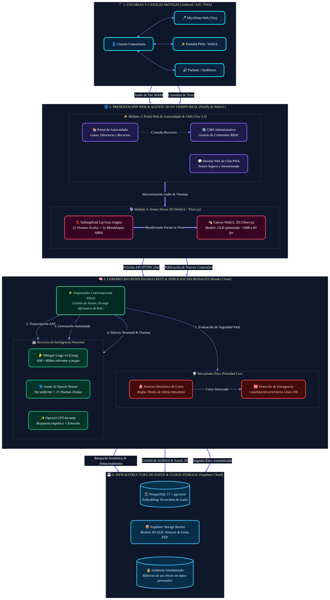

# 📑 Propuesta Técnica y Económica Integral: Plataforma TransLúcidas
### Portal de Autocuidado, Asistente Conversacional RAG y Agente Virtual Encarnado (Alexia 3D)

* **Destinatario:** Equipo de Investigación y Coordinación del Proyecto TransLúcidas
* **Fecha de Emisión:** Octubre de 2026
* **Vigencia de la Oferta:** 30 días calendario
* **Inversión Total del Proyecto Completo (Módulos 1, 2 y 3):** **$15.000.000 COP** (~$3.750 USD)

---

## 1. Descripción de la Solución y Enfoque Arquitectural

La solución para la Plataforma TransLúcidas se concibe como un ecosistema tecnológico integral, culturalmente sensible y optimizado para dispositivos móviles, diseñado para garantizar el acceso confiable a información de autocuidado, orientación en derechos y apoyo comunitario.

La plataforma integra en un solo desarrollo sinérgico tres módulos complementarios:

1. **Módulo 1 — Portal de Autocuidado & Panel CMS:** Espacio web accesible de bajo consumo de datos que reúne guías de salud, directorio de servicios y marco legal, gestionado dinámicamente mediante un panel administrativo con roles de usuario (administración, investigación y creación de contenidos).
2. **Módulo 2 — Asistente Conversacional RAG & Mecanismo Prioridad Cero:** Inteligencia artificial generativa fundamentada estrictamente en documentos y leyes oficiales cargadas en el sistema (con citación de fuente y página), dotada de un interceptor ético de emergencia que detecta situaciones de riesgo vital o crisis emocional y activa de inmediato la derivación a líneas oficiales de ayuda (Línea 106, Línea 123 y Línea Púrpura).
3. **Módulo 3 — Agente Virtual Encarnado (Alexia 3D):** Interfaz multimodal con un personaje 3D en tiempo real ejecutado en el navegador, con voz neuronal cálida y uniforme en cualquier celular, sincronización labial precisa (*lip-sync* con visemas), reconocimiento de voz adaptado a modismos y jergas comunitarias, y un proceso participativo de co-diseño con el equipo e investigadoras comunitarias.

---

### Diagrama de Arquitectura de la Plataforma

A continuación se presenta el flujo integral del sistema, desde la interacción de la usuaria en su dispositivo móvil, pasando por la capa de experiencia web y el cerebro de inteligencia artificial, hasta la infraestructura de datos segura:

---

### Principios Arquitecturales y Éticos de la Solución

1. **Desacoplamiento Estricto:** La interfaz web (Vue 3.5) opera de manera independiente del cerebro de servicios backend (Django REST Framework en Python), lo que permite que cada componente evolucione, reciba mantenimiento o escale sin riesgo de afectar a los demás.
2. **Sustituibilidad de Modelos de IA:** La arquitectura es tecnológicamente agnóstica; el orquestador conversacional está preparado para conectarse indistintamente con diferentes proveedores de modelos de lenguaje (OpenAI GPT-4o-mini, Anthropic Claude 3.5 Sonnet o Google Gemini) sin requerir reescrituras de código.
3. **Privacidad Absoluta y No Revictimización:** Las sesiones de consulta comunitaria son estrictamente anónimas y efímeras. No se capturan direcciones IP, nombres, números telefónicos ni datos biométricos en las bases de datos de consultas.
4. **Eficiencia y Bajo Consumo en Redes Móviles:** El personaje 3D se comprime a menos de 5 MB en formato optimizado GLB con compresión Draco para cargarse una sola vez en la memoria del teléfono; el sitio web carga en menos de 1.5 segundos incluso en conexiones móviles 3G o 4G intermitentes.

---

## 2. Tecnologías, Modelos y Proveedores Recomendados

Cada herramienta ha sido seleccionada cuidadosamente para equilibrar máxima calidad técnica, rapidez de respuesta en dispositivos móviles y costos operativos mínimos:

| Componente | Tecnologías Seleccionadas | Justificación Técnica y Beneficio para el Proyecto |
| :--- | :--- | :--- |
| **Backend Core & API** | Python 3.12+, Django 6+, Django REST Framework, Gunicorn, WhiteNoise, Docker en Render | Robustez empresarial, ORM maduro con protección nativa contra inyecciones SQL, soporte nativo para autenticación granular de roles RBAC y documentación interactiva OpenAPI 3 / Swagger. |
| **Base de Datos & Búsqueda Vectorial** | PostgreSQL 17 + Extensión `pgvector` (Supabase Cloud) | Almacena en una misma base segura los contenidos del CMS, los permisos de usuario y los vectores matemáticos de los documentos para búsqueda semántica, eliminando sobrecostos de bases de datos vectoriales externas. |
| **Frontend Web & Panel CMS** | Vue 3.5, Vite, TypeScript, Pinia, Vanilla CSS | Carga ultraligera (~100 kB comprimido), diseño accesible según pautas internacionales, adaptable a cualquier pantalla móvil o de escritorio, y panel intuitivo para subir y editar guías. |
| **Agente 3D (Alexia)** | WebGL, `Three.js`, motor `TalkingHead` | Renderizado 3D directamente en el procesador gráfico del celular de la usuaria. **Elimina la necesidad de costosos servidores de streaming de video por GPU** (lo que significaría un gasto mensual superior a $400 USD). |
| **Voz Neuronal (TTS) & Sincronización Facial** | **Azure AI Speech Neural** (Voz en español con entonación empática) | **Garantiza una voz humana, cálida e idéntica en cualquier teléfono** (iOS, Android o computador), superando las voces robóticas o variables del navegador. Entrega el audio junto con **15 visemas de Oculus** para sincronización labial exacta. Incluye capa permanente gratuita de 500.000 caracteres mensuales. |
| **Reconocimiento de Voz (ASR)** | **OpenAI Whisper Large-v3** sobre infraestructura Groq | Transcripción de ultra-alta velocidad (<400 ms) diseñada para entender con precisión el lenguaje natural, acentos locales colombianos y el vocabulario o jerga comunitaria propia de la población trans y no binaria. |
| **Motor RAG & Embeddings** | `text-embedding-3-small` + GPT-4o-mini (OpenAI) | Recupera los fragmentos pertinentes de las leyes y guías oficiales para formular respuestas con sustento documental estricto y costo de inferencia mínimo (~$0.02 USD por millón de tokens). |
| **Infraestructura Cloud & CDN** | Netlify (Frontend) + Render (Backend) + Supabase (Datos) | Despliegue automatizado, alta disponibilidad regional, certificados de seguridad SSL automáticos y funcionamiento sobre planes gratuitos o de tarifa base reducida. |

---

## 3. Matriz de Cotización Integral: Proyecto Completo ($15.000.000 COP)

El plan de trabajo comprende **190 horas de ingeniería de software senior** distribuidas a lo largo de **9 a 10 semanas de ejecución**, cubriendo el desarrollo, pruebas, co-diseño y puesta en producción de los tres módulos:

| Fase / Componente | Alcance Técnico y Funcional | Entregables Principales | Horas | Duración | Inversión (COP) | Inversión Ref. (USD) |
| :--- | :--- | :--- | :---: | :---: | :---: | :---: |
| **Fase 1: Arquitectura Base, Entornos Cloud & Marco Ético** | Configuración de infraestructura, diseño de flujos de datos y salvaguardas de privacidad. | • Documento de arquitectura técnica de sistemas y flujos de datos. • Entornos en la nube aprovisionados (Netlify, Render, Supabase). • Protocolo de sesiones anónimas sin almacenamiento de IPs ni datos personales. | 18 h | 1 sem | **$1.500.000** | $375 |
| **Fase 2: Módulo 1 — Portal de Autocuidado & Panel CMS** | Portal web público optimizado para móviles y panel administrativo de contenidos. | • Portal web público responsivo y de bajo consumo de datos móviles. • Catálogo temático de guías de autocuidado y directorio de apoyo. • Panel administrativo CMS con autenticación y roles de usuario (RBAC). • Contador de lecturas y descargas de recursos. | 44 h | 2.5 sem | **$3.500.000** | $875 |
| **Fase 3: Módulo 2 — Asistente RAG & Prioridad Cero** | Motor conversacional fundamentado en fuentes oficiales y detector de emergencias vitales. | • Pipeline de procesamiento, fragmentación y búsqueda vectorial en `pgvector`. • **Mecanismo Ético Prioridad Cero** (alerta vital y derivación Línea 106 / 123). • Generador RAG fundamentado con citas de fuente bibliográfica. • Interfaz web de chat con sesiones efímeras seguras. | 48 h | 2.5 sem | **$4.000.000** | $1.000 |
| **Fase 4: Módulo 3 — Alexia 3D, Voz Neuronal & Co-Diseño** | Interfaz 3D multimodal interactiva, síntesis de voz, reconocimiento adaptado y talleres participativos. | • Avatar 3D optimizado (<5 MB GLB) con 52 expresiones faciales ARKit. • Voz neuronal cálida de Azure con 15 visemas para sincronización labial. • Entrada de voz Whisper con tolerancia a jerga y modismos locales. • **3 sesiones de co-diseño con el equipo e investigadoras comunitarias**. | 50 h | 2.5 sem | **$4.200.000** | $1.050 |
| **Fase 5: Integración Multimodal, Pruebas E2E & Despliegue** | Pruebas integrales de extremo a extremo, configuración de dominios finales y soporte inicial. | • Pruebas automatizadas de rendimiento, sincronización y seguridad. • Despliegue en producción con dominio institucional y certificados SSL. • Manuales de administración, entrega de código fuente y credenciales. • Período de garantía técnica de 90 días calendario. | 30 h | 1.5 sem | **$1.800.000** | $450 |
| **TOTAL PROYECTO INTEGRAL** | **Módulos 1, 2 y 3 Desarrollados e Integrados** | **Plataforma Integral TransLúcidas lista para operación pública** | **190 h** | **9-10 sem** | **$15.000.000 COP** | **$3.750 USD** |

---

## 4. Fortalezas Clave de Nuestra Propuesta

Nuestra propuesta aborda con rigor los retos técnicos y humanos particulares del proyecto:

### 1. Voz Neuronal Homogénea en Todos los Dispositivos (TTS)
Las soluciones basadas únicamente en la síntesis de voz nativa del navegador presentan una gran debilidad: la voz cambia drásticamente entre un celular Samsung, un Xiaomi o un iPhone, sonando frecuentemente metálica o despersonalizada. Con **Azure AI Speech Neural**, garantizamos una voz profesional, empática, humana e idéntica en cualquier teléfono o computador, consolidando la identidad de Alexia como un referente confiable.

### 2. Reconocimiento de Voz Dialectalmente Inclusivo (ASR)
Mediante **Whisper Large-v3 ejecutado en infraestructura Groq**, el sistema no exige que las usuarias se expresen en un lenguaje formal o académico. Reconoce con alta precisión el habla cotidiana, regionalismos colombianos y las expresiones, términos y jergas comunitarias propias de la población trans y no binaria, eliminando barreras de acceso.

### 3. Sincronización Labial Precisa y Modelo 3D Ligero (<5 MB)
En lugar de recurrir a servicios externos de streaming de video por GPU (que demandan alta velocidad de conexión y generan costos recurrentes de cientos de dólares al mes), el avatar de Alexia se renderiza en tiempo real en el propio navegador mediante **WebGL (`Three.js` + `TalkingHead`)**. El modelo pesa menos de 5 MB, se descarga una sola vez y articula con fluidez los **15 visemas de Oculus** a 60 cuadros por segundo.

### 4. Proceso Participativo de Co-diseño Comunitario
La apariencia, gestualidad y vestimenta de Alexia no serán decididas de forma arbitraria ni basadas en plantillas prefabricadas. La propuesta contempla **tres (3) sesiones de trabajo colaborativo** con el equipo de investigación y lideresas comunitarias para revisar propuestas visuales, peinados, accesorios y expresiones faciales, asegurando una representación respetuosa, digna y auténtica.

### 5. Mecanismo Ético de Prioridad Cero (Salvaguarda Vital)
La plataforma incluye un filtro de seguridad activo: si en cualquier momento la usuaria manifiesta ideas de autolesión, crisis emocional aguda o riesgo inminente, el sistema interrumpe de inmediato la consulta estándar de información y activa la **Tarjeta de Crisis con conexión directa a las líneas oficiales gratuitas de orientación psicológica y protección (Línea 106, Línea 123 y Línea Púrpura)**.

### 6. Plataforma Pre-construida y Verificable
No partimos desde cero. Nuestro equipo ya dispone de la arquitectura base desplegada en la nube con pruebas unitarias pasando, base de datos `pgvector` aprovisionada y prototipo funcional probado, lo que reduce drásticamente los riesgos de cronograma e incertidumbre técnica.

---

## 5. Estimación de Costos Recurrentes de Operación

Los servicios de infraestructura de terceros son contratados y titularizados directamente a nombre del proyecto o su entidad titular. Gracias a la eficiencia del diseño, **la plataforma puede operar durante toda la fase de pilotaje con un costo de mantenimiento mensual mínimo**:

| Servicio / Proveedor | Rol en la Plataforma | Capacidad Incluida / Nivel de Uso | Costo Mensual Estimado | Costo Anual Estimado |
| :--- | :--- | :--- | :---: | :---: |
| **Netlify** | Hospedaje y distribución global del Portal y Avatar 3D | Hasta 100 GB de transferencia mensual (Capa Gratuita) | $0 COP | $0 COP |
| **Supabase Cloud** | Base de datos PostgreSQL + `pgvector` + Archivos | 500 MB de base de datos + 1 GB de almacenamiento (Capa Gratuita) | $0 COP | $0 COP |
| **Render Cloud** | Servidor Web API Django REST en contenedor Docker | Servidor estándar 512 MB - 1 GB RAM | $0 – $28.000 COP ($0 - $7 USD) | $0 – $336.000 COP |
| **Azure AI Speech** | Voz Neuronal TTS + 15 Visemas de sincronización | **Capa F0 permanente gratuita:** 500.000 caracteres/mes (~1.250 a 1.500 respuestas de voz al mes sin costo) | $0 COP *(Tier F0)* | $0 COP |
| **Groq (Whisper) & OpenAI** | Transcripción de voz y motor de lenguaje GPT-4o-mini | ~2.000 a 3.000 consultas mensuales | $20.000 – $50.000 COP (~$5 - $12 USD) | $240.000 – $600.000 COP |
| **TOTAL RECURRENTE ESTIMADO** | **Operación integral en fase de pilotaje** | **Infraestructura lista para producción** | **~$20.000 – $78.000 COP/mes** | **~$240.000 – $936.000 COP/año** |

> [!NOTE]
> En caso de que el volumen de uso de voz supere los 500.000 caracteres mensuales gratuitos incluidos en Azure, el costo adicional es sumamente accesible: **$16 USD por cada millón de caracteres adicionales** (aproximadamente $64.000 COP por cada 2.500 a 3.000 respuestas completas de voz).

---

## 6. Matriz de Riesgos y Estrategias de Mitigación

| Riesgo Posible | Nivel | Estrategia de Mitigación Implementada en la Solución |
| :--- | :---: | :--- |
| **Conexiones a internet lentas o intermitentes en celulares** | Alto | El modelo 3D optimizado se almacena en la memoria del dispositivo tras la primera visita; el portal web es liviano (<100 kB comprimido); si la conexión falla, el sistema conmuta automáticamente a modo texto sin interrumpir el servicio. |
| **Riesgo de información imprecisa en temas de salud o derechos** | Alto | El motor RAG consulta exclusivamente los documentos oficiales validados por el equipo del proyecto y cita obligatoriamente la fuente. Si una temática no está contemplada en los documentos, el asistente declara con claridad sus limitaciones. |
| **Diversidad de modismos y jergas comunitarias en los audios** | Medio | Whisper Large-v3 ofrece una robustez lingüística superior a los motores de voz estándar, reconociendo giros locales y términos comunitarios con alta fidelidad. |
| **Dependencia de desarrolladores para actualizar guías y recursos** | Bajo | El Panel CMS permite al equipo investigador publicar, modificar o archivar contenidos de forma autónoma en cualquier momento sin tocar una sola línea de código. |

---

## 7. Criterios de Aceptación y Calidad de la Entrega

La entrega formal de la plataforma se evaluará bajo criterios claros y medibles:

1. ✅ **Portal y CMS Operativos:** Navegación fluida y accesible en celulares y computadores, catálogo temático de recursos funcional y panel administrativo con control de accesos.
2. ✅ **Asistente RAG Fundamentado:** Respuestas coherentes y empáticas respaldadas por citas verificables de los documentos oficiales cargados.
3. ✅ **Seguridad Ética Activa:** Despliegue inmediato de las líneas de ayuda oficiales ante mensajes que involucren riesgo vital o ideación suicida.
4. ✅ **Alexia 3D Multimodal:** Interacción bidireccional por voz y texto, sincronización labial fluida a 60 fps y expresiones emocionales reactivas.
5. ✅ **Interoperabilidad y Documentación:** APIs RESTful estandarizadas con documentación interactiva OpenAPI / Swagger.
6. ✅ **Privacidad Comprobada:** Ausencia de almacenamiento de datos personales sensibles, direcciones IP o rastreadores invasivos.
7. ✅ **Entrega de Ingeniería Completa:** Código fuente documentado en su totalidad, pruebas automatizadas en verde y manuales de administración y despliegue.

---

## 8. Condiciones de Entrega, Garantía y Propiedad Intelectual

* **Propiedad Intelectual Total:** El 100% de los derechos patrimoniales sobre el código fuente desarrollado, los modelos 3D, bases de datos vectorizadas, configuraciones y documentación técnica pertenecerán de manera exclusiva y definitiva al proyecto TransLúcidas y a su entidad titular.
* **Garantía Técnica de Estabilidad:** **90 días calendario** posteriores a la puesta en producción para corregir cualquier inconsistencia, fallo o ajuste técnico sin costo adicional.
* **Transferencia de Conocimiento:** Sesión de capacitación práctica al equipo del proyecto para la administración del CMS, carga de nuevos documentos a la base de conocimiento y monitoreo de métricas.

---

## 9. Esquema de Facturación e Hitos de Pago

Para asegurar un desarrollo ordenado y transparente, se propone un cronograma de desembolsos vinculado a hitos de entrega tangibles y verificables:

| Hito de Pago | Porcentaje | Valor (COP) | Entregable Clave Vinculado |
| :---: | :---: | :---: | :--- |
| **Hito 1 (Anticipo de Inicio)** | **30%** | **$4.500.000** | Firma del acta de inicio, documento de arquitectura técnica y aprovisionamiento de entornos cloud base. |
| **Hito 2 (Entrega Módulo 1 & CMS)** | **25%** | **$3.750.000** | Portal web de autocuidado, catálogo temático de recursos y panel CMS funcional probado. |
| **Hito 3 (Entrega Módulo 2 & RAG)** | **25%** | **$3.750.000** | Asistente conversacional RAG, base vectorial `pgvector` poblada y protocolo de crisis Prioridad Cero activo. |
| **Hito 4 (Entrega Módulo 3 & Cierre)** | **20%** | **$3.000.000** | Alexia 3D integrada con voz neuronal, sesiones de co-diseño completadas, despliegue final y entrega de código. |
| **TOTAL** | **100%** | **$15.000.000 COP** | **Plataforma Integral TransLúcidas en Producción** |

---

*Propuesta técnica y económica formulada con los más altos estándares de ingeniería de software, accesibilidad digital y sensibilidad comunitaria para el proyecto TransLúcidas.*
